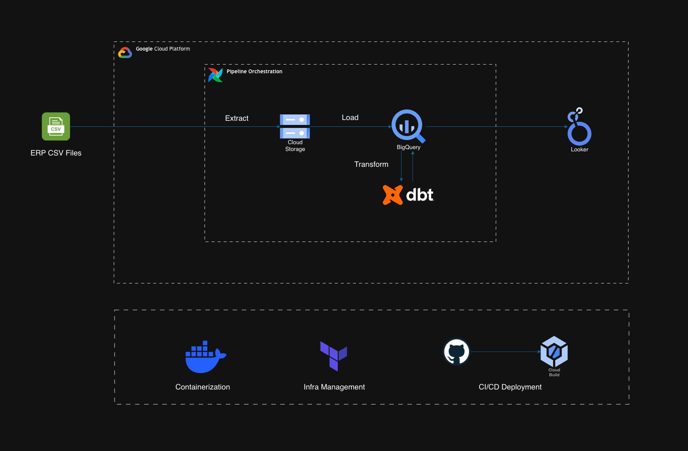

# E-Commerce Data Warehouse


## 🧭 Project Overview

Welcome to the **Brazil Ecommerce Data Warehouse and Analytics Project** repository! 🚀  
This project demonstrates a comprehensive data warehousing and analytics solution, from building a data warehouse to generating actionable insights. Designed as a portfolio project, it highlights industry best practices in data engineering and analytics.

This project involves:

1. **Data Architecture**: Designing a modern data warehouse using Medallion Architecture **Bronze**, **Silver**, and **Gold** layers.
2. **ETL Pipelines**: Extracting, transforming, and loading data from source systems into the warehouse.
3. **Data Modeling**: Developing fact and dimension tables optimized for analytical queries.
4. **Analytics & Reporting**: Creating SQL-based reports and dashboards for actionable insights.

## Data Architecture



## Terraform configuration

The scripts in [`terraform/`](terraform/) provision the Google Cloud environment for this project:

| File | Purpose |
| --- | --- |
| [`provider.tf`](terraform/provider.tf) | Configures `hashicorp/google` with version `>= 6.8.0` and the target project. No Terraform CLI version or remote state backend is configured. |
| [`variables.tf`](terraform/variables.tf) | Defines project, region, service account names, IAM roles, bucket settings, and local dataset path. |
| [`iam_service_accounts.tf`](terraform/iam_service_accounts.tf) | Creates the three service accounts, Airflow key, and project IAM memberships. |
| [`gcs.tf`](terraform/gcs.tf) | Creates the bucket and uploads files matching `**/*.csv`. |
| [`cloud_build.tf`](terraform/cloud_build.tf) | Defines repository/branch variables and creates the GitHub build trigger. |
| [`outputs.tf`](terraform/outputs.tf) | Exposes `airflow_service_account_key_base64` as a sensitive output. |

### Build the environment

#### 1. Initialize 

```bash
cd terraform
terraform init
```

#### 2. Validate

```bash
terraform validate
```

#### 3. Plan

```bash
terraform plan
```

#### 4. Apply

```bash
terraform apply
```

#### 5. Generate credential output

```bash
terraform output -json > outputs_tf.json
```

#### 6. Extract and decode the Airflow service account key

```bash
jq -r '.airflow_service_account_key_base64.value' outputs_tf.json | \
base64 --decode > ../airflow/keys/airflow_service_account.json
```

#### 7. Delete environment

To remove the Terraform-managed resources:

```bash
terraform destroy
```
